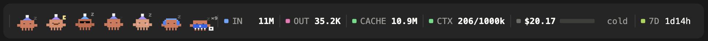
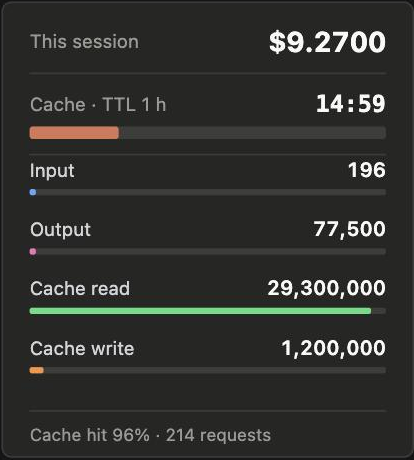
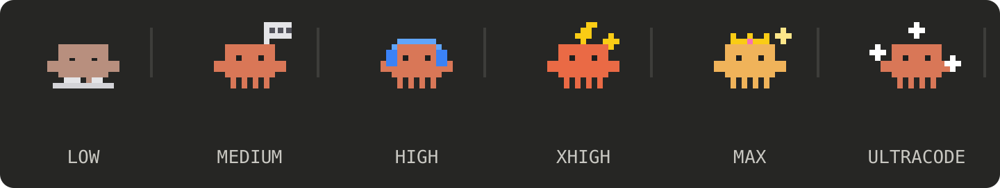

<div align="center">

# session-meter

**See what your Claude Code session costs, when the prompt cache dies, and where your tokens go.**
A live strip above the prompt, a hover card with the details, and seven little pixel Clodies in different costumes that run while Claude works.




</div>

---

## Features

### The strip

| Segment | What it shows |
| --- | --- |
| `IN` | All input tokens for the session, as the API counts them: new + cache read + cache write |
| `OUT` | Output tokens |
| `CACHE` | Tokens read from the prompt cache |
| `$` | What the session has cost so far |
| bar + clock | The prompt cache draining to zero — 1 hour by default, `/meter 5m` for the 5‑minute cache |
| `CTX` | Context used, as `used/limit` in thousands of tokens, e.g. `123/600k`. The limit follows your `/autocompact` setting for the current model and falls back to the model's whole window (e.g. `1000k`) when none is set; it updates as soon as you change it. Marker green → yellow → red |
| `5H` / `7D` | Time until your 5‑hour and 7‑day usage limits reset (`3:26` / `3d03h`). When both are known, one readout turns like a wheel: 5H stays for 2:30, then 7D for 30 s, and back; the whole plate scrolls down as one and the next face arrives from above. The marker beside it runs smoothly from green through yellow to red as that limit fills. Shown only when your account reports the limit |

Numbers are abbreviated as **K / M / B**. Every segment has a fixed width, so nothing jumps when the numbers change.
The countdown runs *inside* the picture, so the strip is never redrawn on a timer.

### Hover for the full picture

Hover the strip and a card opens above it with exact counts, cache‑write tokens, cache hit rate, the number of requests and how much of the 5‑hour and 7‑day limits is used. `/meter` shows the same card in a pane.

<div align="center">

</div>

### Lo‑fi button

At the right end of the strip there is a **▶** button. Press it and a menu opens upwards with eight long-running 24/7 live streams, each with its YouTube preview:

| Stream | Channel |
| --- | --- |
| [lofi hip hop radio](https://www.youtube.com/watch?v=rFZHOHl-L8A) | Lofi Girl |
| [Claude FM](https://youtu.be/tRsQsTMvPNg) | Claude |
| [synthwave radio](https://www.youtube.com/watch?v=4xDzrJKXOOY) | Lofi Girl |
| [sleep/chill radio](https://www.youtube.com/watch?v=JD-kMIpDfnY) | Lofi Girl |
| [jazz lofi radio](https://www.youtube.com/watch?v=E2vONfzoyRI) | Lofi Girl |
| [lofi hip hop radio](https://www.youtube.com/watch?v=7NOSDKb0HlU) | Chillhop Music |
| [Chillhop Radio](https://www.youtube.com/watch?v=5yx6BWlEVcY) | Chillhop Music |
| [sad & sleepy beats](https://www.youtube.com/watch?v=FWjZ0x2M8og) | the bootleg boy |

Pick one and it plays in the background – sound only, no window, no video. The button turns into **■**; press it to stop. The music also stops when Claude Code closes.

**The stream's picture plays beside the prompt.** A small borderless video window (224×126, no sound of its own) opens in the empty corner to the right of the prompt, level with it, and moves with the Claude window. It stays on top while Claude is the app in front and steps back when you switch to another app. Claude's own interface has no place a mod can play video in, so this is a window of mpv's own; `/meter video off` turns it off (`on` brings it back).

**The Clodies dance while it plays.** Whenever they are standing – or as soon as they come to rest after Claude has worked – they dance to one beat: bobbing, pumping their arms, stepping from foot to foot, each with a move of its own (a sway, a side step, a squash); the footballer juggles his ball and music notes rise over a few of them. The music also keeps them from dozing off when the cache goes cold.

The music starts the moment you pick: while the menu is open, the last stream you picked and the first two are already loading, paused, and the pick just unpauses one; the others start in two or three seconds. The previews load in the background as soon as a session starts (all at once, in about half a second), then the streams' addresses.

Playback starts a few segments behind the live edge and keeps up to a minute read ahead, with a fresh connection per segment and automatic reconnects, so it does not stall. The volume starts at 60 (about −13 dB); change it with `/meter volume 0–100`.

It plays through [mpv](https://mpv.io) with [yt-dlp](https://github.com/yt-dlp/yt-dlp); if they are missing, the button tells you to install them:

```
brew install mpv yt-dlp
```

### Clodies

Seven pixel Clodies live on the left of the strip, in an evenly spaced row.

- **Working** – they run to the right in a line, one after another, and re‑enter from the left.
- **Done** – they keep walking, slowing down smoothly, and settle into an even row.
- **Standing** – each has its own routine: a double jump, waving in turns, swaying, stretching, a turn‑around with a little heart.
- **Cache gone cold** – they fall asleep.
- **The footballer** – the seventh Clodie wears a blue kit. He dribbles a ball while the others run, and when standing he kicks it out to a neighbour and lets it roll back.
- **They react to what happens:**
  - a tool fails → they droop, a tear falls;
  - tests pass, or a round sum ($10, $20 …) is spent → they hop, cheer and throw confetti;
  - a tool call runs long (8 s+) → one of them opens an umbrella;
  - your prompt says *find / search / grep* → one gets a magnifier; *fix / bug* → one gets a hammer (until the answer ends);
  - the footballer scores a goal after every successful answer, and keeps the score (`×N` above him).
- **Time of day** – nightcaps (and a moon) from 22:00 to 06:00, coffee mugs in the morning, party hats on Friday evening.
- **Five idle minutes** – they pass a wave along the row, and shimmer in turn once a minute.

### The sixth Clodie shows your reasoning level

<div align="center">

</div>

---

## Install

In a Claude Code session:

```
/plugin install session-meter --marketplace grosa787/claude-session-meter
```

or from a shell:

```
claude plugin install session-meter --marketplace grosa787/claude-session-meter
```

Open sessions need a restart to pick it up.

### Updating

Every push to this repository is a new version. To get it, run `/plugin marketplace update` and then `/plugin update session-meter` (or turn on auto-update for this marketplace in `/plugin`), and restart open sessions.

## Commands

| Command | Does |
| --- | --- |
| `/meter` | Opens the stats card in a pane |
| `/meter 1h` / `/meter 5m` | Sets the cache lifetime used for the countdown |
| `/meter reset` | Resets the token counters |
| `/meter video on` / `/meter video off` | Shows or hides the stream's picture beside the prompt (on by default) |
| `/meter volume 40` | Sets the lo‑fi volume, 0–100 (60 by default); applies at once and is remembered. `/meter volume` alone shows it |

## Good to know

- The strip, the Clodies and the card are SVG, so they appear in **Claude Code Desktop**. On a terminal the mod falls back to a plain text line and hover card, without the Clodies.
- **Reasoning level** is read from your settings and from each request. Max is not stored in settings, so it shows once `effortLevel` disappears from them or after the first request following the switch.
- **Ultracode** is detected from the `ultracode` setting, or from the word `ultracode` in a prompt (for that turn). Claude Code does not expose the mode to mods in any other way.
- The *find* / *fix* reactions also recognise a few Russian words (найди, поиск, почини, баг).
- Token counters are kept per session in the mod's store, so they survive a full restart of Claude; the cost is read from the session itself.
- The lo‑fi button lives in each session's strip on its own: pressing it in two sessions plays the stream twice.

## How it works

The mod is a single hooks module (`hooks/register.tsx`). It listens to model responses for token usage and to session measurements for cost, keeps them in the mod's state, and draws the strip into the band above the prompt. All animation is SVG/SMIL, so the only redraws happen when something actually changes.

## License

MIT © grosa787
